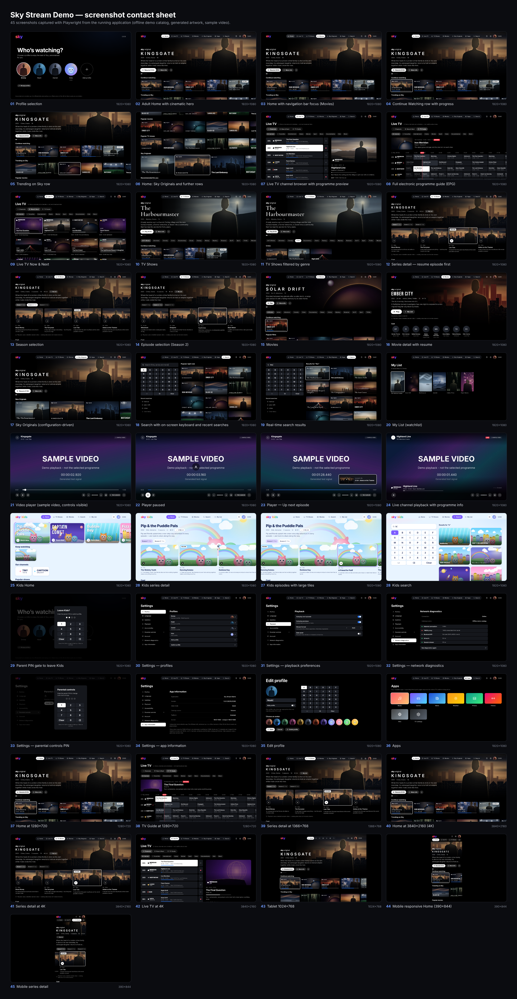

# Screenshot index

Captured by `npm run screenshots` (Playwright, `tests/e2e/screenshots.spec.ts`) against the running app with
`CATALOG_SOURCE=fixtures` (offline demo catalog: fictional titles and locally generated artwork). Playback shows the
generated, clearly labelled sample video.

| # | Screen | Viewport | Route | File |
|---|--------|----------|-------|------|
| 1 | Profile selection | 1920×1080 | `/profiles` | [01-profile-selection.png](01-profile-selection.png) |
| 2 | Adult Home with cinematic hero | 1920×1080 | `/` | [02-home.png](02-home.png) |
| 3 | Home with navigation bar focus (Movies) | 1920×1080 | `/` | [03-home-navigation-focus.png](03-home-navigation-focus.png) |
| 4 | Continue Watching row with progress | 1920×1080 | `/` | [04-continue-watching.png](04-continue-watching.png) |
| 5 | Trending on Sky row | 1920×1080 | `/` | [05-trending.png](05-trending.png) |
| 6 | Home: Sky Originals and further rows | 1920×1080 | `/` | [06-home-originals-row.png](06-home-originals-row.png) |
| 7 | Live TV channel browser with programme preview | 1920×1080 | `/live` | [07-live-tv-channels.png](07-live-tv-channels.png) |
| 8 | Full electronic programme guide (EPG) | 1920×1080 | `/live/guide` | [08-live-tv-guide.png](08-live-tv-guide.png) |
| 9 | Live TV Now & Next | 1920×1080 | `/live/now-next` | [09-live-tv-now-next.png](09-live-tv-now-next.png) |
| 10 | TV Shows | 1920×1080 | `/tv` | [10-tv-shows.png](10-tv-shows.png) |
| 11 | TV Shows filtered by genre | 1920×1080 | `/tv?genre=crime` | [11-tv-genre.png](11-tv-genre.png) |
| 12 | Series detail — resume episode first | 1920×1080 | `/tv/demo%3Atv%3Akingsgate` | [12-series-detail.png](12-series-detail.png) |
| 13 | Season selection | 1920×1080 | `/tv/demo%3Atv%3Akingsgate` | [13-season-selection.png](13-season-selection.png) |
| 14 | Episode selection (Season 2) | 1920×1080 | `/tv/demo%3Atv%3Akingsgate?season=2` | [14-episode-selection.png](14-episode-selection.png) |
| 15 | Movies | 1920×1080 | `/movies` | [15-movies.png](15-movies.png) |
| 16 | Movie detail with resume | 1920×1080 | `/movies/demo%3Amovie%3Aember-city` | [16-movie-detail.png](16-movie-detail.png) |
| 17 | Sky Originals (configuration-driven) | 1920×1080 | `/originals` | [17-sky-originals.png](17-sky-originals.png) |
| 18 | Search with on-screen keyboard and recent searches | 1920×1080 | `/search` | [18-search.png](18-search.png) |
| 19 | Real-time search results | 1920×1080 | `/search` | [19-search-results.png](19-search-results.png) |
| 20 | My List (watchlist) | 1920×1080 | `/watchlist` | [20-watchlist.png](20-watchlist.png) |
| 21 | Video player (sample video, controls visible) | 1920×1080 | `/watch/episode/demo%3Atv%3Akingsgate/1/3` | [21-video-player.png](21-video-player.png) |
| 22 | Player paused | 1920×1080 | `/watch/episode/demo%3Atv%3Akingsgate/1/3` | [22-player-paused.png](22-player-paused.png) |
| 23 | Player — Up next episode | 1920×1080 | `/watch/episode/demo%3Atv%3Akingsgate/1/3` | [23-player-up-next.png](23-player-up-next.png) |
| 24 | Live channel playback with programme info | 1920×1080 | `/watch/channel/meridian-drama` | [24-live-player.png](24-live-player.png) |
| 25 | Kids Home | 1920×1080 | `/kids` | [25-kids-home.png](25-kids-home.png) |
| 26 | Kids series detail | 1920×1080 | `/kids/title/tv/demo%3Atv%3Apip-and-the-puddle-pals` | [26-kids-series-detail.png](26-kids-series-detail.png) |
| 27 | Kids episodes with large tiles | 1920×1080 | `/kids/title/tv/demo%3Atv%3Apip-and-the-puddle-pals` | [27-kids-episodes.png](27-kids-episodes.png) |
| 28 | Kids search | 1920×1080 | `/kids/search` | [28-kids-search.png](28-kids-search.png) |
| 29 | Parent PIN gate to leave Kids | 1920×1080 | `/profiles` | [29-kids-parent-pin.png](29-kids-parent-pin.png) |
| 30 | Settings — profiles | 1920×1080 | `/settings` | [30-settings.png](30-settings.png) |
| 31 | Settings — playback preferences | 1920×1080 | `/settings/playback` | [31-settings-playback.png](31-settings-playback.png) |
| 32 | Settings — network diagnostics | 1920×1080 | `/settings/network` | [32-settings-network.png](32-settings-network.png) |
| 33 | Settings — parental controls PIN | 1920×1080 | `/settings/parental` | [33-settings-parental-pin.png](33-settings-parental-pin.png) |
| 34 | Settings — app information | 1920×1080 | `/settings/about` | [34-settings-about.png](34-settings-about.png) |
| 35 | Edit profile | 1920×1080 | `/profiles/p-noah/edit` | [35-profile-edit.png](35-profile-edit.png) |
| 36 | Apps | 1920×1080 | `/apps` | [36-apps.png](36-apps.png) |
| 37 | Home at 1280×720 | 1280×720 | `/` | [40-home-720p.png](40-home-720p.png) |
| 38 | TV Guide at 1280×720 | 1280×720 | `/live/guide` | [41-guide-720p.png](41-guide-720p.png) |
| 39 | Series detail at 1366×768 | 1366×768 | `/tv/demo%3Atv%3Akingsgate` | [42-series-1366x768.png](42-series-1366x768.png) |
| 40 | Home at 3840×2160 (4K) | 3840×2160 | `/` | [43-home-4k.png](43-home-4k.png) |
| 41 | Series detail at 4K | 3840×2160 | `/tv/demo%3Atv%3Akingsgate` | [44-series-4k.png](44-series-4k.png) |
| 42 | Live TV at 4K | 3840×2160 | `/live` | [45-live-4k.png](45-live-4k.png) |
| 43 | Tablet 1024×768 | 1024×768 | `/` | [46-tablet.png](46-tablet.png) |
| 44 | Mobile responsive Home (390×844) | 390×844 | `/` | [47-mobile-home.png](47-mobile-home.png) |
| 45 | Mobile series detail | 390×844 | `/tv/demo%3Atv%3Akingsgate` | [48-mobile-series.png](48-mobile-series.png) |
